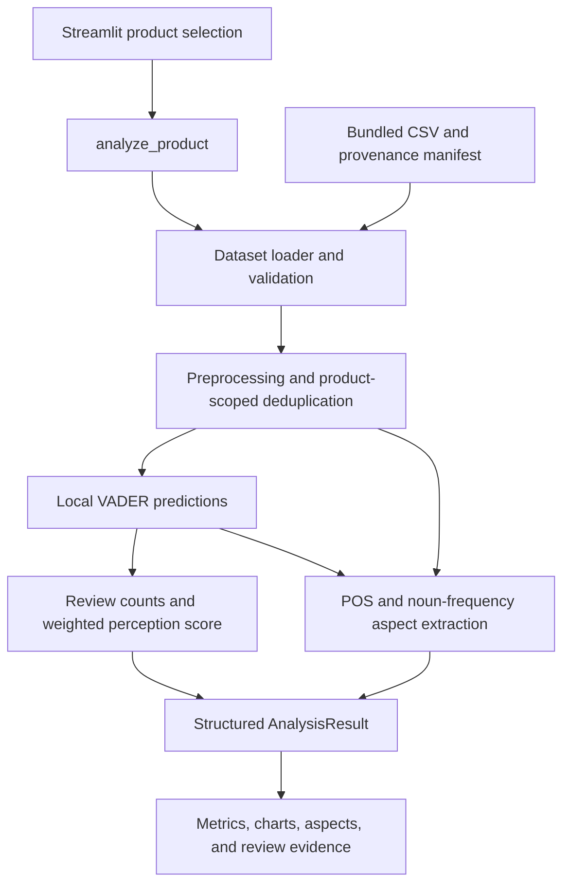

# Perceptra - Product Perception Intelligence

## 1. Project introduction

Perceptra helps small businesses and product teams understand customer feedback at
both product and feature level. Its goal is to turn scattered reviews into useful
sentiment summaries, supporting evidence, and product-improvement insights.

The current MVP is a **local, dataset-backed Streamlit application**. It analyzes
real, historical clothing reviews with VADER and estimates feature sentiment from
reviews mentioning each feature. It is a working demonstration prototype, not a
production system or a validated measure of current market perception.

The original project vision also includes multi-source collection, contextual
aspect-based sentiment, competitive benchmarking, PostgreSQL, and Airflow. Those
capabilities are future work; they are not required to run this MVP.

## 2. Working features

- Select either of two real anonymized clothing products from the bundled dataset.
- Validate data, filter language/unusable text, preserve sentiment cues, and remove
  duplicate text within a product.
- Classify reviews as positive, negative, or neutral with actual local VADER inference.
- Calculate overall perception ratings and retain individual predictions/evidence.
- Extract POS-tagged frequent nouns and estimate their sentiment with stable review-ID joins.
- Inspect sentiment charts/counts, aspect estimates, and supporting customer reviews.
- Search original review text, filter by sentiment, and browse 25 reviews per page.
- Clear outdated results when changing products and handle empty/error states.
- Run a structured analysis CLI independently of Streamlit.
- Operate offline after dependency and NLTK setup, without credentials or paid APIs.

Live ecommerce ingestion, hosted Hugging Face inference, contextual ABSA, TF-IDF,
product comparison, persistence, orchestration, and production deployment are not
implemented. The separate legacy YouTube collector is optional and not live-verified.

## 3. Technology stack

| Technology | Current responsibility |
|---|---|
| Python | Processing, contracts, preparation, CLI, and application logic |
| Streamlit | Native dashboard, tables, metrics, tabs, and Vega-Lite chart rendering |
| `vaderSentiment` | Local lexicon/rule-based sentiment scoring; lexicon bundled with package |
| `langdetect` | Statistical language filtering using packaged profiles |
| NLTK | Tokenization, English POS tagging, and stopwords for aspect extraction |
| Python CSV/JSON/hash libraries | Dataset preparation, loading, provenance, and integrity checks |
| pytest / Streamlit AppTest | Component, integration, compatibility, and simulated UI tests |

`pyproject.toml` is the **single source of dependency declarations**.
`requirements.txt` installs the editable runtime project; `requirements-dev.txt`
adds its `dev` extra. Streamlit's transitive dependencies include Pandas/NumPy.

The optional `collectors` extra declares `google-api-python-client` and
`python-dotenv`. Normal installation excludes them. Transformers, PyTorch,
PostgreSQL drivers, Airflow, and hosted-inference clients are not MVP dependencies.

## 4. Project structure

```text
perceptra/
+-- .env.example                    Optional configuration examples; no secrets
+-- .gitignore
+-- .streamlit/config.toml           Native theme; usage telemetry disabled
+-- README.md
+-- pyproject.toml                   Package/dependencies/extras/pytest settings
+-- requirements.txt
+-- requirements-dev.txt
+-- perceptra/
|   +-- __init__.py
|   +-- config.py                    Project paths and local NLTK resource checks
|   +-- schemas.py                   Shared review, prediction, and result contracts
|   +-- analysis.py                  Unified service and supported product-analysis CLI
|   +-- ingestion/
|   |   +-- __init__.py
|   |   +-- dataset_loader.py        Deterministic preparation and offline loading
|   |   +-- youtube.py               Optional explicitly invoked collection
|   +-- nlp/
|       +-- __init__.py
|       +-- cleaner.py               Conservative normalization, filtering, deduplication
|       +-- sentiment.py             VADER facade and review-level aggregation
|       +-- aspects.py               POS/frequency estimates and review-ID evidence joins
+-- app/streamlit_app.py             UI; delegates analysis to the service
+-- scripts/prepare_demo_data.py     Local CSV import and explicit NLTK preparation
+-- data/
|   +-- processed/
|   |   +-- demo_reviews.csv         Included CC0 demonstration subset
|   |   +-- manifest.json            Included provenance and checksums
|   +-- raw/                        Optional original CSV; ignored, not needed to run
+-- tests/
|   +-- conftest.py                  Authored fixtures and offline guards
|   +-- test_imports.py
|   +-- test_data.py
|   +-- test_preprocessing.py
|   +-- test_sentiment.py
|   +-- test_aspects.py
|   +-- test_pipeline.py
|   +-- test_dashboard.py
|   +-- test_youtube.py
+-- docs/
|   +-- demo.md                     Focused mentor demonstration runbook
|   +-- day2-verification.md         Historical Day 2 verification
|   +-- day3-verification.md         Final setup/testing/handoff evidence
+-- fetch_youtube.py                Compatibility wrappers delegating to the package
+-- save_data.py
+-- clean_data.py
+-- sentiment_analysis.py
+-- dynamic_aspects.py
```

`.venv/`, Python/build/test caches, editable-install metadata, and `data/raw/` are
local generated artifacts. No database, cloud configuration, or model directory
is needed. The five root scripts contain adapters, not duplicated NLP algorithms.

## 5. Architecture and data flow



The service loads one product, cleans its records, scores them, computes the overall
summary, and attaches aspect estimates. Aspect ratings do not replace the overall
review-based rating. Data loading, processing, and visualization remain separate.
There is no REST API, database, scheduled DAG, or live request in this workflow.

## 6. Prerequisites

- Python **3.11+** as declared by packaging. The complete clean-environment check
  was performed on **Python 3.13.6 on Windows**; other versions/platforms were not
  independently verified. Python 3.13 is the documented verification reference.
- Git to obtain the repository and Windows PowerShell or CMD to run commands.
- A current desktop browser. Real-browser checks used installed Microsoft Edge.
- Internet access during initial package/NLTK installation. Normal analysis uses
  local files and needs no internet, account, token, database, or GPU.
- Local disk space for the virtual environment, downloaded resources, and installation
  caches. Observed clean installation sizes were about 350 MiB for `Lib`, 2 MiB for
  `Scripts`, and 22 MiB for NLTK data, excluding pip/build caches and base Python.
  These are observations, not a fixed storage minimum.
- A CPU-based developer computer. RAM/CPU minimums and performance guarantees have
  not been benchmarked; no GPU-specific hardware is required by the implemented code.

VS Code is optional. Select `.venv\Scripts\python.exe` with **Python: Select
Interpreter** so editor actions use the same interpreter as the commands below.

## 7. Complete installation guide

Run these commands from the repository root. Do not install packages globally.

### Clone

```powershell
git clone https://github.com/Xtract01/perceptra.git
cd perceptra
```

The maintainer must publish any local changes before they appear in a new clone.
Day 3 verification used a tracked-file source snapshot and a fresh environment;
it did not create another Git checkout or change the remote repository.

### Create the project virtual environment

```powershell
python -m venv .venv
```

This is the one bootstrap command run before `.venv` exists. It creates an isolated
interpreter; it does not install project packages into system Python. If `python`
is unavailable but the Windows launcher is installed, a version-selecting bootstrap
command for this project's reference version is:

```powershell
py -3.13 -m venv .venv
```

For an existing working checkout, keep its `.venv`; do not recreate it unnecessarily.

### Optional activation

PowerShell:

```powershell
.\.venv\Scripts\Activate.ps1
```

CMD:

```cmd
.venv\Scripts\activate.bat
```

Activation only adjusts the current shell. It is not proof of interpreter identity.
The explicit interpreter paths below work even when activation is blocked:

```powershell
.\.venv\Scripts\python.exe -c "import sys; print(sys.executable); print(sys.prefix); print(sys.base_prefix)"
```

The executable/prefix must point into this clone's `.venv`; the base prefix should
be the underlying Python installation.

### Install dependencies

For runtime use:

```powershell
.\.venv\Scripts\python.exe -m pip install -r requirements.txt
```

For development/testing, also run:

```powershell
.\.venv\Scripts\python.exe -m pip install -r requirements-dev.txt
```

The second command includes runtime requirements and adds pytest. It is safe after
the first install; dependencies are not declared twice. Do not run `pip freeze >
requirements.txt`: that would overwrite the project's installation entry point.

### Prepare NLTK resources once

```powershell
.\.venv\Scripts\python.exe scripts/prepare_demo_data.py --prepare-nltk
```

This explicit setup command downloads `punkt_tab`, `averaged_perceptron_tagger_eng`,
and `stopwords` **only into `.venv/nltk_data/`**. No transformer weights are involved.
The application restricts NLTK's resource search to that directory, ignoring a
user's global cache and `NLTK_DATA` locations. Imports/inference never download data.

NLTK setup is necessary for aspect estimates. Without it, VADER still runs and the
application reports unavailable aspects instead of inventing results.

### Verify required setup

```powershell
.\.venv\Scripts\python.exe -m pip check
.\.venv\Scripts\python.exe -c "import perceptra; print(perceptra.__file__)"
.\.venv\Scripts\python.exe -m perceptra.analysis --list-products
.\.venv\Scripts\python.exe -m perceptra.analysis --product "clothing:1078" --summary
.\.venv\Scripts\python.exe -m perceptra.analysis --product "clothing:862" --summary
```

Expected: consistent dependencies, package import from this clone, two catalog
entries, and completed analyses with nonempty `aspect_analysis.aspects` after
NLTK setup. `--summary` omits individual scored reviews; it does not change analysis.

**Dataset regeneration is not required.** The included processed CSV and manifest
are sufficient. No `.env` file or secret credential is required for the dashboard.

## 8. Running the Streamlit dashboard

From the repository root:

```powershell
.\.venv\Scripts\python.exe -m streamlit run app/streamlit_app.py
```

The normal local address is `http://localhost:8501`. Open the address printed by
Streamlit. For an explicit loopback address and fixed presentation port:

```powershell
.\.venv\Scripts\python.exe -m streamlit run app/streamlit_app.py --server.address 127.0.0.1 --server.port 8501
```

Select a product and click **Analyze product**. The overview shows analyzed count,
overall perception, and three sentiment percentages. Tabs expose the distribution,
feature estimates and their evidence, and the review explorer. Review search is
case-insensitive; pages contain at most 25 reviews. Aspect evidence previews at
most ten supporting reviews. Changing products clears previous results and filters.

Stop Streamlit with **Ctrl+C** in its launching terminal and wait for it to exit.
Closing the browser alone does not stop the server. Restart with the same command.
See the port-conflict recovery steps below if the chosen port is occupied.

## 9. Running individual tasks and configuration

| Task | Supported entry point |
|---|---|
| Catalog/manifest/checksum validation | `python -m perceptra.analysis --list-products` |
| Complete product analysis | `python -m perceptra.analysis --product "clothing:1078" --summary` |
| Dataset regeneration | `scripts/prepare_demo_data.py --input-csv ...` (optional; next section) |
| NLTK setup | `scripts/prepare_demo_data.py --prepare-nltk` |
| Preprocessing existing raw JSON | `clean_data.py --input raw_comments.json --output cleaned_comments.json` |
| VADER analysis of existing cleaned JSON | `sentiment_analysis.py --input cleaned_comments.json --output sentiment_results.json` |
| Aspect estimates from existing JSON outputs | `dynamic_aspects.py --query "Product name" --input cleaned_comments.json --sentiment sentiment_results.json --output aspect_results.json` |

In the table, **always invoke `python` as `.\.venv\Scripts\python.exe`**. The three
legacy file commands require their named input JSON files; they are not additional
steps required by the dataset-backed dashboard. Their functions retain practical
legacy outputs and share the package implementations. They were checked with real
bundled reviews in disposable JSON files.

There is no separate CLI for `load_reviews()` or `analyze_text()`. Use their Python
interfaces, or the unified service:

```python
from perceptra.analysis import analyze_product
from perceptra.ingestion.dataset_loader import list_products, load_reviews
from perceptra.nlp.sentiment import analyze_text

products = list_products()
reviews = load_reviews("clothing:1078")
prediction = analyze_text("I love this dress!", engine="vader")
result = analyze_product("clothing:1078", engine="vader")
```

`perceptra/config.py` resolves default paths from the editable project location,
not the current working directory. The optional process environment variable
`PERCEPTRA_DATA_DIR` changes the data root; it must contain `processed/` with both
files. The analysis CLI also accepts `--data-dir`. NLTK remains in this clone's
`.venv/nltk_data/`. Core configuration does **not** automatically load `.env`.

The optional YouTube code lives in `perceptra/ingestion/youtube.py`. Its dependencies
are declared by the `collectors` extra; only explicit collection loads `.env`/reads
`YOUTUBE_API_KEY` and initializes the client. Normal imports and dashboard use never
collect data. This collector's live API access is unverified and is not part of the
required installation or mentor demonstration. CLI options are available through:

```powershell
.\.venv\Scripts\python.exe fetch_youtube.py --help
.\.venv\Scripts\python.exe save_data.py --help
```

## 10. Dataset and optional regeneration

- **Dataset:** Women's E-Commerce Clothing Reviews, version 1.
- **Publisher/curator:** Kaggle account `nicapotato`; the original retailer is anonymous.
- **Source:** [publisher dataset page](https://www.kaggle.com/datasets/nicapotato/womens-ecommerce-clothing-reviews).
- **License declaration:** [publisher metadata](https://www.kaggle.com/datasets/nicapotato/womens-ecommerce-clothing-reviews/metadata), CC0-1.0.
- **Prepared files:** `data/processed/demo_reviews.csv` and `manifest.json`, both included in the repository.

The original CSV has 23,486 rows; 22,641 have valid IDs/nonempty review text.
Preparation rejects 845 empty/invalid records, ranks products by valid review
count descending and numeric Clothing ID ascending, and takes the first 200
source-order reviews per selected product. No sentiment results or star ratings
influence selection. Product labels use actual Clothing IDs and categories, not
fabricated brand/model names.

| Product | Valid source reviews | Prepared subset |
|---|---:|---:|
| Clothing 1078 - Dresses | 987 | 200 |
| Clothing 862 - Knits | 778 | 200 |

Stable review IDs retain original source row IDs. The manifest records provenance,
selection policy, excluded fields, version, and SHA-256 integrity checks. Ratings,
recommendation flags, positive-feedback counts, age, and title are excluded from
NLP inputs. Likes are zero; helpful-feedback counts are not substituted for likes.

Source CSV SHA-256:

```text
bd93cc515747ad1f87b8bc863c9e40da758509e6db6506a96d06976e61e36ee0
```

Prepared CSV SHA-256:

```text
965943770b4b4479f5a037d036128d30ee9404be4e1a28517205d1d3ca8f0ae0
```

To regenerate **optionally**, obtain the version-1 publisher CSV, place it at
`data/raw/Womens Clothing E-Commerce Reviews.csv` (create `raw/` if needed), then run:

```powershell
.\.venv\Scripts\python.exe scripts/prepare_demo_data.py --input-csv "data/raw/Womens Clothing E-Commerce Reviews.csv"
```

The script accepts another local CSV path too and copies that source into ignored
`data/raw/`. It does not download dataset records. To compare regeneration safely
without overwriting the included subset:

```powershell
.\.venv\Scripts\python.exe scripts/prepare_demo_data.py --input-csv "data/raw/Womens Clothing E-Commerce Reviews.csv" --data-dir ".venv/day3-regenerated"
```

Day 3 reproduced the exact included manifest and prepared checksum. Ordinary setup
was also verified with no original CSV present. Historical anonymized reviews and
a limited subset cannot establish current market-wide product perception.

## 11. Understanding results

**Sentiment labels.** VADER compound ranges from -1 to +1. A score at least +0.05
is positive; at most -0.05 is negative; values between are neutral. The score is a
lexicon/rule-based sentiment measure, not a calibrated probability or accuracy.
Predictions include explicit engine/model/version metadata, raw scores, and
`class_probabilities=None`.

**Overall perception.** The existing formula is:

```text
weight = 1 + log(1 + likes)
overall_score = sum(compound * weight) / sum(weight)
perception_rating = 5 * (overall_score + 1)
```

Zero likes makes every weight one, so this dataset uses the mean review compound
mapped to 0-10. It is **not a customer star-rating average**. Counts/percentages
refer to retained analyzed reviews. Original = rejected + duplicates + analyzed;
positive + negative + neutral = analyzed. Empty results have unavailable ratings.
Calculations retain precision; the UI rounds only for presentation.

**Aspects.** The extractor POS-tags nouns, ranks their frequency, filters through
an existing dimension list, and uses a frequent-noun fallback when needed. Exact
whole tokens determine review support. Sentiment joins use review IDs, not text
identity; missing/invalid predictions are excluded rather than assumed neutral.

Each aspect's estimate maps the mean compound of supporting whole reviews onto
0-10. A review praising design but criticizing material can therefore give both
features the same overall review sentiment. This is **not contextual ABSA**.
Supporting review count measures distinct reviews; mention count measures noun
occurrences and can be larger.

| Evidence volume | Supporting reviews |
|---|---:|
| Low | Fewer than 7 |
| Medium | 7-14 |
| High | At least 15 |

These tiers describe evidence quantity, not model accuracy. The original minimum-
length, English-language, and question filters can discard useful opinions; rejection
counts expose their effect. Sarcasm, mixed sentiment, and noisy nouns remain limitations.

## 12. Testing guide

Complete suite:

```powershell
.\.venv\Scripts\python.exe -m pytest -q --basetemp=.venv/day3-test-tmp
.\.venv\Scripts\python.exe -m pip check
```

Focused pipeline/UI/offline checks:

```powershell
.\.venv\Scripts\python.exe -m pytest tests/test_pipeline.py tests/test_dashboard.py -q --basetemp=.venv/day3-focused-tmp
```

For an individual file, replace the test paths with a listed file such as
`tests/test_aspects.py`. Pipeline execution is independently available through
`python -m perceptra.analysis` with the explicit `.venv` interpreter above.

`test_dashboard.py` uses Streamlit AppTest in isolated `.venv` subprocesses. It
covers real result display and controlled failure cases. Other tests cover data
integrity, identifiers, provenance, label leakage, preprocessing, scoring formulas,
ID joins, evidence tiers, imports, legacy adapters, and product isolation. Authored
fixtures are synthetic tests, never substituted for demonstration data.

The tests block external network access and runtime NLTK downloads; Windows'
internal loopback coordination is allowed in AppTest. Offline CLI analysis was
also tested with credentials removed. Internet is needed only for initial setup.

A passing run exits zero. A failed assertion, dependency problem, or timeout needs
investigation; a prior report does not prove a later environment passes. **Verification
snapshot, October 28, 2026:** 71 tests passed in both the original and fresh Windows
Python 3.13.6 environments. See [Day 3 evidence](docs/day3-verification.md).

For actual-browser checks, launch the dashboard and follow [the runbook](docs/demo.md).
Check both products, stale-result clearing, aspect evidence, a matching search,
an empty search, negative filtering, and page 2. Inspect at common desktop sizes.
AppTest alone is not browser verification. Day 3 used real Edge automation with
temporary task helpers; those helpers are not a packaged browser-test command.

## 13. Live mentor demonstration guide

### Before presenting

Activate `.venv` if desired, then verify interpreter identity, `pip check`, both
prepared files, `--list-products`, and one `--summary` analysis using the commands
above. Run the tests beforehand rather than during the live presentation. Check
that the chosen port is free:

```powershell
Get-NetTCPConnection -LocalPort 8501 -State Listen -ErrorAction SilentlyContinue
```

An empty result means no listener was found. If occupied, identify its owner; do
not kill unrelated applications. Use the alternate-port command in troubleshooting.

### Start

Run the explicit localhost command from section 8 and open `http://127.0.0.1:8501`.
Allow the first analysis to load local NLP resources. Keep [docs/demo.md](docs/demo.md)
open as the concise speaking/runbook reference.

### Demonstration sequence and suggested narration

| Action | What to say |
|---|---|
| Introduce Perceptra | "We turn customer reviews into product sentiment summaries and feature estimates." |
| Explain the data | "This is a real CC0 historical dataset with anonymized Clothing IDs, not live scraping." |
| Select Clothing 1078 - Dresses; Analyze | "The button runs our actual local preprocessing, VADER, and aspect pipeline." |
| Explain count, distribution, rating | "These values are calculated from retained reviews; the rating is an NLP indicator, not customer stars." |
| Open Aspect estimates | "Nouns are extracted from review text; each estimate uses reviews mentioning the term." |
| Expand supporting evidence | "Review IDs connect these estimates to original review evidence." |
| Search/filter reviews and open page 2 | "We can inspect the underlying predictions rather than just show aggregate charts." |
| Switch to Clothing 862; Analyze again | "Old results disappear on selection changes. This is an independent product analysis." |
| Explain current scope | "The working MVP includes local ingestion, analysis, evidence, UI, and tests." |
| Explain limitations/future work | "Mixed feature opinions are not separated yet; contextual ABSA, benchmarking, and automation are future objectives." |

### After presenting

Press Ctrl+C in the launching terminal, wait for process exit, and recheck the
presentation port. Restart with the same launch command if needed. Close only
the demo browser/profile you opened; closing a tab alone does not stop Streamlit.

## 14. Windows troubleshooting

| Problem | Recovery |
|---|---|
| Python not recognized | Install the reference Python version or use the Windows `py` launcher; confirm the interpreter before creating `.venv`. |
| Python version below 3.11 | Use a suitable interpreter for a new project `.venv`; do not alter system packages. |
| PowerShell blocks activation | Skip activation and use `.\.venv\Scripts\python.exe` directly. No execution-policy change is necessary. |
| Activation points at another environment | Close/reactivate the shell or use explicit paths; print `sys.executable` and `sys.prefix`. |
| Missing packages | Run the appropriate requirements installation through this project's `.venv` interpreter, then `pip check`. |
| `No module named perceptra` | Run editable installation from the repository root and ensure VS Code uses the same `.venv`. Do not patch `sys.path`. |
| Missing NLTK resources | Run the explicit `--prepare-nltk` setup command; verify `.venv/nltk_data/`, not a global cache. |
| Missing/invalid dataset | Check both bundled processed files and the `PERCEPTRA_DATA_DIR` override. Obtain intact repository copies from the maintainer; the original CSV is not required. Regenerate only if you have the publisher source and intend to replace the subset. |
| Checksum mismatch | Restore the expected prepared CSV/manifest pair or regenerate them together. Do not edit the checksum just to hide a mismatch. |
| Streamlit fails to start | Read terminal errors, verify `.venv`, run `pip check`, check the working directory and port, then retry. |
| Invalid port/configuration | Supply a numeric free port and correct invalid overrides; configuration errors occur before the UI starts. |
| Empty analysis | Inspect rejection counts and warnings; ensure reviews are nonempty and pass retained language/length filters. No rating is fabricated. |
| Unexpected sentiment/aspects | Inspect original review evidence; VADER and whole-review feature estimates have known limitations. Do not manually change statistics. |

To clear a mistaken data override in the current PowerShell session:

```powershell
Remove-Item Env:PERCEPTRA_DATA_DIR -ErrorAction SilentlyContinue
```

Port conflicts: inspect the listener and identify its process without stopping it:

```powershell
Get-NetTCPConnection -LocalPort 8501 -State Listen -ErrorAction SilentlyContinue
```

If an unrelated application owns 8501, leave it running and use:

```powershell
.\.venv\Scripts\python.exe -m streamlit run app/streamlit_app.py --server.address 127.0.0.1 --server.port 8502
```

Open `http://127.0.0.1:8502` and stop that instance with Ctrl+C afterward. Never use
commands that indiscriminately terminate all Python, Edge, or Node processes.

## 15. Developer handoff

| Work area | Where to change and what to preserve |
|---|---|
| New ingestion source | `perceptra/ingestion/`; return normalized review records with stable product/review IDs and provenance. Keep network collection explicit. |
| Cleaning/filtering | `nlp/cleaner.py`; preserve sentiment cues and reconciliation of rejected/duplicate/analyzed counts. |
| New sentiment engine | `nlp/sentiment.py`; extend explicit validation/metadata and output contracts, keeping VADER default. Preserve probability/score distinctions and never silently switch engines. |
| Improved aspects | `nlp/aspects.py`; preserve review-ID joins and evidence. Evaluate contextual attribution separately from the current proxy. |
| Service orchestration | `analysis.py`; keep it independent of Streamlit and retain structured empty/error behavior. |
| Dashboard | `app/streamlit_app.py`; render service values rather than duplicate scoring, and test state reset/filter behavior. |
| Shared contracts | `schemas.py`; make additive changes where possible and update service/UI/tests together. |
| Configuration | `config.py` and `.streamlit/config.toml`; keep paths clone-local and do not introduce required secrets. |
| Tests | Add focused pytest cases for behavior and failures. UI tests must not contaminate headless import checks. |

Keep compatibility wrappers delegating to the canonical package. Do not change
stable IDs, score meanings, threshold boundaries, or JSON keys without reviewing
all consumers. Keep real dataset provenance separate from authored test fixtures.

After the mentor demonstration, four contributors can own ingestion, NLP/aspects,
dashboard, and integration/testing/docs. Agree shared schema changes first, use
feature branches and pull requests under the maintainer's workflow, and integrate
small changes. No branches or Git writes were performed by the verification task.

## 16. Future roadmap - not current capabilities

- Maintained multi-source ingestion and safer live collection.
- Category-adaptive aspect/phrase extraction and TF-IDF evaluation.
- Contextual aspect-based sentiment analysis and labeled model evaluation.
- Optional appropriately licensed Hugging Face models, subject to the free-only
  constraint and approval before large weight downloads; published weights do not
  guarantee a free hosted endpoint.
- Competitive benchmarking with comparable products/evidence.
- Self-hosted PostgreSQL persistence and analysis history.
- Self-hosted Apache Airflow scheduling, retries, and monitoring.
- Accuracy/latency evaluation, deployment, and operational improvements.

## 17. Licensing and attribution

The publisher declares the dataset **CC0-1.0**, a public-domain dedication; its
[official terms](https://creativecommons.org/publicdomain/zero/1.0/) do not impose
an attribution condition. This project nevertheless retains the publisher/source,
version, selection details, and checksums so the demonstration is reproducible.
Do not imply endorsement by the original retailer, curator, or dataset publisher.

The dataset's dedication does **not** license the application source code.
**No repository software LICENSE file is currently present; this README does not
claim that Perceptra's source is MIT-licensed.** The maintainers should agree and
add an appropriate software license separately. Dependencies retain their own
licenses; their licensing does not automatically license this repository.
